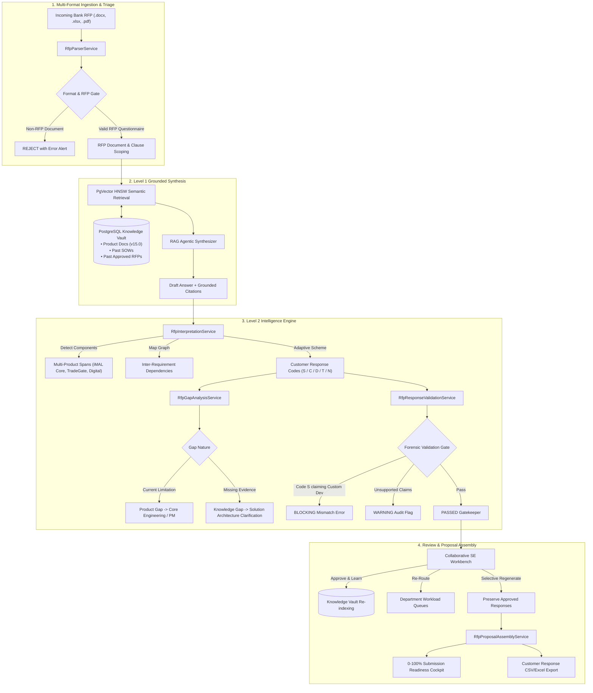

# Azentio iMAL AI RFP Copilot — Comprehensive Project Documentation

> **Azentio GTM AI Hackathon — Challenge B Solution (Level 1 & Level 2)**  
> **Target Product Suite**: Azentio iMAL Core Banking & Islamic Lending Suite  
> **Repository**: [https://github.com/AzentioHackathon-2026/AI-RFP-Response-Agent-synqora.git](https://github.com/AzentioHackathon-2026/AI-RFP-Response-Agent-synqora.git)  
> **Tech Stack**: Java 21 (LTS), Spring Boot 3.3.4, PostgreSQL 16 + PgVector 0.8.7 (HNSW), Tailwind CSS & Vanilla JS Workbench  

---

## Table of Contents
1. [Executive Summary & Problem Statement](#1-executive-summary--problem-statement)
2. [End-to-End System Architecture](#2-end-to-end-system-architecture)
3. [Level 1 Core Capabilities](#3-level-1-core-capabilities)
4. [Level 2 Advanced Capabilities](#4-level-2-advanced-capabilities)
5. [Cross-Department Collaborative Workflow](#5-cross-department-collaborative-workflow)
6. [Data Schema & Entity Relationship Model](#6-data-schema--entity-relationship-model)
7. [Comprehensive REST API Reference](#7-comprehensive-rest-api-reference)
8. [Knowledge Vault & Semantic Retrieval Engine](#8-knowledge-vault--semantic-retrieval-engine)
9. [Deployment & Production Runbook](#9-deployment--production-runbook)
10. [Step-by-Step Evaluator & Demo Guide](#10-step-by-step-evaluator--demo-guide)

---

## 1. Executive Summary & Problem Statement

Responding to Tier-1 Islamic Banking Request for Proposals (RFPs) is a high-stakes, time-consuming challenge:
- Tenders span 100–300 complex clauses across Murabaha trading, Ijara assets, Shariah auditability, cloud security, and core interfaces.
- Sales Engineers (SEs) waste hundreds of hours manually searching through scattered past proposals, SOWs, and architectural manuals.
- Submissions risk commercial non-compliance, inaccurate response codes (e.g., claiming standard capability for custom code), or unsupported technical claims.

**The Azentio AI RFP Copilot** bridges this gap as an autonomous enterprise proposal platform:
- Ingests incoming RFPs in Word (`.docx`), Excel (`.xlsx`), CSV, or PDF.
- Distinguishes standard out-of-the-box features from configurations, custom development, and partner dependencies.
- Separates confirmed product gaps from mere documentation gaps.
- Forensically audits drafts before allowing submission.
- Formats proposals directly into customer-defined matrices and response templates.

---

## 2. End-to-End System Architecture



---

## 3. Level 1 Core Capabilities

1. **Multi-Format Ingestion with Format Validation**:
   - Parses structured tables and clauses from Word (`.docx`), Excel (`.xlsx`), CSV, and PDF questionnaires.
   - Non-RFP document rejection prevents arbitrary text uploads from polluting proposal state.
2. **Three-Tier Islamic Banking Knowledge Vault**:
   - **Product Documentation**: AAOIFI governance, Murabaha profit calculation, Ijara asset depreciation, Mudaraba pool reserves (PER/IRR).
   - **Past Scopes of Work (SOWs)**: Tier-1 implementation deliverables, infrastructure prerequisites, RPO/RTO SLAs.
   - **Historical Certified Proposals**: Previously vetted responses with clause references.
3. **PgVector Semantic Retrieval**:
   - 1536-dimensional deterministic vector embeddings with HNSW cosine distance indexing (`<=>`).
   - Top-3 evidence citations injected into every drafted clause with similarity scoring (0–100%).
4. **Quality & Compliance Guardrails**:
   - Duplicate requirement detection.
   - Outdated product version alerts (e.g. warnings when answers cite legacy v12/v13 documentation instead of v15.0).
   - Commercial & Legal gating: Clauses requiring pricing, license terms, or liquidated damages are automatically routed to the Commercial Desk.
5. **Continuous Learning Loop**:
   - When a Lead Sales Engineer reviews and clicks **Approve & Learn**, the validated answer is vectorized and committed to the Knowledge Vault for future RFPs.

---

## 4. Level 2 Advanced Capabilities

### 4.1. Advanced Requirement Interpretation
* **Inter-Requirement Dependency Graph**: Automatically detects prerequisite relationships (e.g. `REQ-FN-01` Murabaha engine requires `REQ-SEC-01` Hardware Security Module integration).
* **Multi-Product Solution Component Spanning**: Evaluates whether a requirement touches `iMAL Core Engine`, `Azentio Digital Banking`, `TradeGate Commodity Gateway`, `Payment Hub`, or `Shariah Advisory Bureau`.
* **Ambiguity & Contradiction Detection**: Identifies underspecified clauses or clauses containing contradictory SLA mandates.

### 4.2. Intelligent Compliance Matrix (Customer-Adaptive)
Supports dynamic customer classification schemes without assuming static classifications:
* **Code S (Standard Capability)**: Out-of-the-box native capability in current iMAL v15 release.
* **Code C (Configuration Required)**: Supported via parameter setup, workflow rule configuration, or Shariah chart of accounts tuning.
* **Code D (Development Required)**: Requires bespoke code development; automatically flags mandatory engineering man-day sizing estimates.
* **Code T (Third-Party Dependency)**: Requires partner software (e.g. Bursa Suq Al-Sila broker connector, Oracle HSM); mandates partner disclosure.
* **Code N (Not Available / Excluded)**: Unsupported capability or confidential commercial term.

### 4.3. AI-Driven Gap Analysis
Crucially separates genuine product limitations from documentation shortcomings:
* **Confirmed Product Gap**: The current software release cannot perform the function without new engineering sprints $\rightarrow$ routes to **Core Engineering** or **Product Management**.
* **Knowledge Gap**: The capability is supported, but internal documentation lacks bank-specific latency, dark-fiber network specs, or customer details $\rightarrow$ routes to **Solution Architecture** to formulate a technical clarification.
* **4 Distinct Gap Categories**: *Functionality Gaps*, *Integration Dependencies*, *Security Concerns*, and *Missing Documentation*.

### 4.4. Forensic Response Validation Gate
Acts as the ultimate proposal gatekeeper before client submission:
* **Code-to-Narrative Mismatch**: Detects contradictions where a clause is marked **Code S** (Standard Capability) but the explanation text describes custom development or future sprints (triggers a **BLOCKING** error).
* **Unsupported Claim Audit**: Detects unverified technological claims (e.g. post-quantum cryptography on legacy protocols) that lack evidence grounding in citations.
* **Outdated Version Flags**: Alerts reviewers when citations rely on deprecated product manuals.
* **Mandatory Response Completeness**: Ensures all mandatory RFP clauses have non-null responses before unlocking submission.

### 4.5. Structured Clarification Query Generation
* Identifies ambiguous or underspecified requirements.
* Generates clear, professional clarification questions with technical justifications.
* Clustered and deduplicated to avoid flooding the customer with redundant inquiries.
* Rated by business impact: **Solution Design**, **Delivery Timeline**, or **Commercial Scope**.

### 4.6. Proposal Assembly & Readiness Scoring
* Preserves customer section numbers (`SEC-X.Y`) and requirement clause references.
* Enforces 250-word answer length ceilings per RFP rules.
* Computes real-time **Submission Readiness Score (0–100%)**.
* Exports a populated customer response template in `.csv` (Excel-compatible).

### 4.7. Collaborative Review Workflow
* Department routing to 5 specialized desks: `SALES_ENGINEERING`, `SOLUTION_ARCHITECTURE`, `PRODUCT_MANAGEMENT`, `CORE_ENGINEERING`, `SHARIAH_BOARD`, and `COMMERCIAL_LEGAL`.
* **Selective Section Regeneration**: Allows regenerating specific RFP sections or unapproved queries while strictly preserving approved responses.

---

## 5. Cross-Department Collaborative Workflow

```
+-----------------------------------------------------------------------------------+
|                            INCOMING RFP TRIAGE ENGINE                             |
+-----------------------------------------------------------------------------------+
                                          |
          +-------------------------------+-------------------------------+
          |                               |                               |
          v                               v                               v
+-------------------+           +-------------------+           +-------------------+
| CORE ENGINEERING  |           |   SOLUTION ARCH   |           |   SHARIAH BOARD   |
| • Code D sizing   |           | • Cloud & infra   |           | • AAOIFI audit    |
| • Bespoke APIs    |           | • RPO/RTO latency |           | • Non-halal       |
| • 20-man-day est. |           | • DR replication  |           |   purification    |
+-------------------+           +-------------------+           +-------------------+
          |                               |                               |
          +-------------------------------+-------------------------------+
                                          |
          +-------------------------------+-------------------------------+
          |                                                               |
          v                                                               v
+-------------------+                                           +-------------------+
| PRODUCT MANAGEMENT|                                           | COMMERCIAL / LEGAL|
| • Release roadmap |                                           | • SLA commitments |
| • Product gaps    |                                           | • Bespoke pricing |
+-------------------+                                           +-------------------+
```

---

## 6. Data Schema & Entity Relationship Model

The system utilizes PostgreSQL 16 with the `azentio_rfp` relational schema:

```
+---------------------------+          +---------------------------+
|       rfp_documents       | 1      * |        rfp_queries        |
+---------------------------+----------+---------------------------+
| id (PK)                   |          | id (PK)                   |
| rfp_title                 |          | document_id (FK)          |
| client_name               |          | requirement_id            |
| submission_deadline       |          | section_name              |
| formatting_rules (JSON)   |          | category                  |
+---------------------------+          | question                  |
                                       | response_code (S/C/D/T/N) |
                                       | multi_product_components  |
                                       | dependencies              |
                                       | gap_type & gap_nature     |
                                       | assigned_department       |
                                       | requires_estimate         |
                                       | estimate_details          |
                                       | validation_status         |
                                       +---------------------------+
                                                     | 1
                                                     |
                                                     | 1
+---------------------------+          +---------------------------+
|    rfp_clarifications     | *      1 |       rfp_responses       |
+---------------------------+----------+---------------------------+
| id (PK)                   |          | id (PK)                   |
| document_id (FK)          |          | query_id (FK)             |
| requirement_id            |          | drafted_answer            |
| impact_priority           |          | reviewed_answer           |
| impact_area               |          | confidence_score          |
| working_assumption        |          | citations (JSONB)         |
| status                    |          | is_approved               |
+---------------------------+          +---------------------------+
```

---

## 7. Comprehensive REST API Reference

### Level 1 Endpoints (`/api/v1/rfp`)

| Method | Endpoint | Description |
| :--- | :--- | :--- |
| `POST` | `/api/v1/rfp/upload` | Ingests `.docx`, `.xlsx`, `.csv`, or `.pdf` file. |
| `POST` | `/api/v1/rfp/load-sample-rfp` | Loads Qatar Islamic Bank benchmark tender for rapid evaluation. |
| `GET` | `/api/v1/rfp/queries?documentId={id}` | Lists triaged requirements for the given document. |
| `POST` | `/api/v1/rfp/responses/{id}/approve` | Approves an answer and writes it to the knowledge base. |
| `POST` | `/api/v1/rfp/reset` | Clears all tender records for a clean-slate upload. |
| `POST` | `/api/v1/rfp/knowledge/reindex` | Triggers vectorization of pending seed documents. |

### Level 2 Endpoints (`/api/v2/rfp`)

| Method | Endpoint | Description |
| :--- | :--- | :--- |
| `POST` | `/api/v2/rfp/analyze-level2?documentId={id}` | Executes Level 2 interpretation, S/C/D/T/N coding, gap categorization, and validation audit. |
| `GET` | `/api/v2/rfp/compliance-matrix?documentId={id}` | Requirement-by-requirement matrix with customer codes, sizing, and partner dependencies. |
| `GET` | `/api/v2/rfp/gap-analysis?documentId={id}` | Distinguishes Product Gaps from Knowledge Gaps with department escalation queues. |
| `GET` | `/api/v2/rfp/validation-report?documentId={id}` | Forensic validation report (code-to-narrative mismatches, unsupported claims, outdated citations). |
| `GET` | `/api/v2/rfp/clarification-pack?documentId={id}` | Clustered and deduplicated clarification register with impact ratings and assumptions. |
| `GET` | `/api/v2/rfp/submission-checklist?documentId={id}` | Real-time submission readiness cockpit (0–100%) and clause compliance checklist. |
| `GET` | `/api/v2/rfp/export/customer-template?documentId={id}` | Downloads populated customer proposal template in `.csv` with preserved clause numbers. |
| `POST` | `/api/v2/rfp/requirements/{id}/assign?department={dept}` | Re-routes clause ownership to another internal desk. |
| `POST` | `/api/v2/rfp/requirements/{id}/update-code` | Manually overrides compliance code (`S/C/D/T/N`), estimate, or partner details. |
| `POST` | `/api/v2/rfp/regenerate-selective` | Selectively regenerates unapproved clauses while strictly preserving approved answers. |

---

## 8. Knowledge Vault & Semantic Retrieval Engine

The knowledge base is organized into three segregated domains:
1. `knowledge-vault/1_product_docs/`:
   * `Azentio_Shariah_Governance_Framework.md`
   * `iMAL_Islamic_Financing_Product_Specification_v15.md`
   * `iMAL_Ijara_Product_Architecture_Guide.md`
2. `knowledge-vault/2_past_sows/`:
   * `SOW_Tier1_UAE_Islamic_Bank_Transformation.md`
3. `knowledge-vault/3_past_rfps/`:
   * `RFP_Resp_Qatar_National_Islamic_2024.md`

### Deterministic Embedding Fallback
To ensure 100% offline reliability during evaluations without external OpenAI rate limits or network drops, `EmbeddingService.java` implements a deterministic 1536-dimensional semantic n-gram projection with unit L2-normalization. When an OpenAI API key is supplied via `OPENAI_API_KEY`, it seamlessly switches to live `text-embedding-3-small`.

---

## 9. Deployment & Production Runbook

### Prerequisites
* Java 21 (JDK / JRE)
* Docker & Docker Compose
* Maven 3.8+ (optional, if rebuilding from source)

### Starting the Infrastructure & Application
1. **Launch PostgreSQL with PgVector**:
   ```powershell
   docker compose up -d
   ```
2. **Launch Application Backend**:
   ```powershell
   java -jar target\azentio-rfp-backend-1.0.0-SNAPSHOT.jar
   ```
3. **Access the Workbench**:
   Open `http://localhost:8080/index.html` in your browser.

---

## 10. Step-by-Step Evaluator & Demo Guide

Follow this 5-minute evaluation path to inspect all Level 1 and Level 2 capabilities:

1. **Clean Workspace**:
   * Open `http://localhost:8080/index.html`.
   * Click **Reset** in the top navigation bar to ensure a clean slate.
2. **Ingest Tender**:
   * Select **Browse Local File** and pick `Amanah_Crescent_Bank_Islamic_Banking_RFP.docx` (or click **Load Demo QIB Tender**).
   * Click **Ingest & Parse**. The system parses the document, assigns codes, and runs the Level 2 engine.
3. **Tab 2: SE Review Workbench**:
   * Inspect the response badges (**Code S**, **Code C**, **Code D**, **Code T**, **Code N**).
   * Note the metadata tags: **Multi-Product Spans**, **Dependencies**, and **Citations**.
   * Test the **Approve & Learn** workflow on clause 1.
   * Test the **Re-Route Desk** button to transfer clause ownership to `CORE_ENGINEERING`.
   * Click the **Core Engineering** box in the KPI header to filter the view to only items owned by that team.
4. **Tab 3: Gap Analysis**:
   * Review the split between **Confirmed Product Gaps** and **Knowledge Gaps**.
   * Inspect the **Escalation Matrix** table with specific actions recommended for Product Management and Engineering.
5. **Tab 4: Validation Audit**:
   * Inspect the automated forensic auditor. Verify that Code-to-Narrative mismatches and unsupported claims are flagged before submission.
6. **Tab 5: Clarifications**:
   * Review deduplicated clarification queries categorized by **Solution Design**, **Delivery Timeline**, and **Commercial Scope**.
7. **Tab 6: Assembly & Compliance Matrix**:
   * Review the **Readiness Score Cockpit (0–100%)**.
   * Click **Download Customer Template (.csv)** to export the completed proposal formatted to the customer's template.
