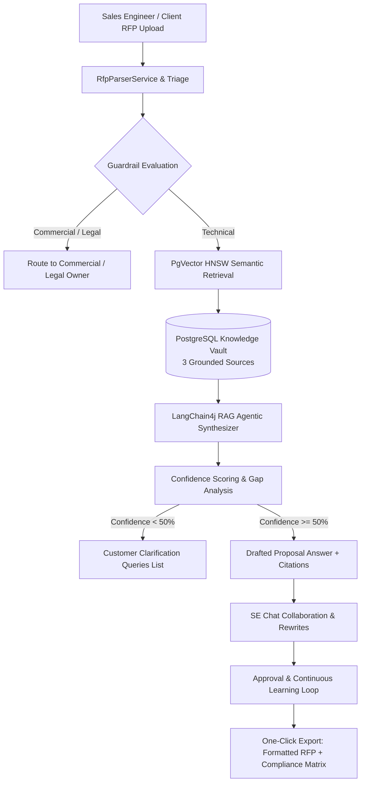

# Azentio Agent 2: AI RFP Response Agent (Islamic Banking & Lending)
> **Azentio GTM AI Hackathon — Challenge B Solution**  
> *Target Product Suite: Azentio iMAL Core Banking & Islamic Lending Suite*

---

## Executive Overview & Purpose

The **RFP Agent** is an enterprise copilot built specifically for **Sales Engineers (SEs)** responding to complex **Islamic Banking and Lending RFPs**. 

Instead of manually digging through 200-page proposal archives and product manuals, the SE uploads an RFP in chat, and the agent works with them question by question:
1. **Parses & Triages** the RFP sections, requirements, and formatting rules.
2. **Retrieves Grounded Knowledge** from **3 distinct sources**:
   - 📘 **Product Documentation** (Azentio iMAL product guides, Murabaha engine, Ijara, Mudaraba, AAOIFI governance)
   - 📄 **Past Scopes of Work (SOWs)** (Redacted Tier-1 banking transformation deliverables)
   - 📑 **Past RFP Responses** (Audited and certified historical proposal answers)
3. **Enforces Enterprise Guardrails**:
   -  **SE in Control**: Every answer remains a draft until explicitly reviewed and approved by the Sales Engineer.
   -  **Commercial & Legal Triage**: Pricing, license fees, SLA liquidated damages, and contractual commitments are **never** auto-generated; they are flagged for the Commercial Desk or Legal Counsel.
   -  **Confidentiality / Client Redaction**: Past customer bank names are sanitized (`[REDACTED_TIER1_ISLAMIC_BANK]`).
   -  **Source Quality Warning**: Flags when knowledge originates from outdated product versions (e.g. iMAL v12/v13 vs current v15.0).
4. **Clarification Query Compilation**: Generates a consolidated, deduplicated list of questions to send to the client with technical justification instead of inventing assumptions.
5. **Generates Full Compliance Matrix**: Compliant (`C`), Partially Compliant (`PC`), Non-Compliant (`NC`), Clarification Needed (`CL`).
6. **Conversational Collaboration & Memory**: SE instructs the agent in chat ("Rewrite to emphasize AAOIFI compliance", "Shorten answer to 200 words", "Approve answer").

---

##  Architecture & Tech Stack

- **Backend**: Spring Boot 3.3.4 (Java 21 LTS)
- **Vector Database**: PostgreSQL 16 + PgVector 0.8.7 (`vector(1536)` with HNSW cosine distance `<=>`)
- **Agent Orchestration**: LangChain4j 0.36.2 + OpenAI (`gpt-4o-mini`) with offline deterministic n-gram fallback
- **Frontend**: React + Tailwind CSS Sales Engineering Workbench
- **Persistence**: Spring Data JPA + JSONB citations + Session chat memory

---

## 📡 Key REST Endpoints

| Method | Endpoint | Description |
| :--- | :--- | :--- |
| `POST` | `/api/v1/rfp/load-sample-rfp` | **Instant Judge Demo:** Ingests Qatar Islamic Bank RFP with 5 sections & formatting rules |
| `GET` | `/api/v1/rfp/queries` | List all parsed RFP questions with status, citations, and owners |
| `POST` | `/api/v1/rfp/query` | Process a single RFP question through PgVector and triage |
| `POST` | `/api/v1/rfp/chat` | Conversational collaboration: instruct agent to rewrite, shorten, or explain |
| `GET` | `/api/v1/rfp/compliance-matrix` | Full compliance matrix (`C`, `PC`, `NC`, `CL`) |
| `GET` | `/api/v1/rfp/clarifications` | Consolidated customer clarification queries with reasons |
| `POST` | `/api/v1/rfp/responses/{id}/approve` | SE approval & continuous learning (saves back to Knowledge Vault) |
| `GET` | `/api/v1/rfp/export/all` | Export formatted proposal report adhering to RFP rules |

---
